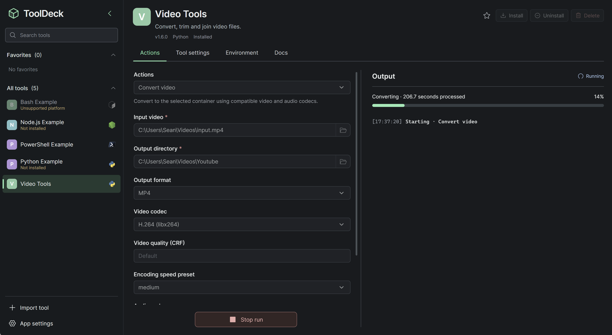

# ToolDeck

English | [简体中文](README.zh-CN.md)

ToolDeck is a desktop app for running local script tools on Windows, macOS and Linux. Import a tool as a ZIP and its manifest becomes a form: select an action, choose files or enter parameters, then follow its progress and open the results. Each tool declares its own platform and runtime requirements.

| Guide | Start here to… |
| --- | --- |
| [Application guide](docs/user-guide.md) | Import a tool, set up its environment, run an action and manage its data. |
| [Tool package development](docs/tool-development.md) | Turn a Python, Node.js, Bash or PowerShell script into an importable tool. |

## Run from source

Install Node.js with npm, Rust and the Tauri 2 development prerequisites for your platform. From the repository root:

~~~sh
npm install
npm run desktop:dev
~~~

To try a tool, run `npm run package:examples`, then import a ZIP from `artifacts/tools`. The [example sources](examples/) cover all four runtimes.

## Build and test

~~~sh
npm run desktop:build
npm run build
npm test
cargo test --manifest-path src-tauri/Cargo.toml --lib
~~~

The first command builds the desktop executable. The second checks TypeScript and builds the frontend. For tests that exercise Python or uv, use `TOOLDECK_TEST_PYTHON` or `TOOLDECK_TEST_UV` to select the executable. The uv integration tests also need Python on `PATH`.

## Publish a release

Run `npm run set-version -- 0.2.0` with the new version. This updates the npm, Tauri and Cargo version declarations and both lockfiles. Commit the changes before tagging the release.

Push a Git tag matching the Tauri app version (for example, `v0.1.0` for version `0.1.0`). GitHub Actions builds a Windows x64 installer, a universal macOS disk image and a Linux x64 Debian package. Once all three builds succeed, it publishes the installers to the GitHub Release for that tag.
