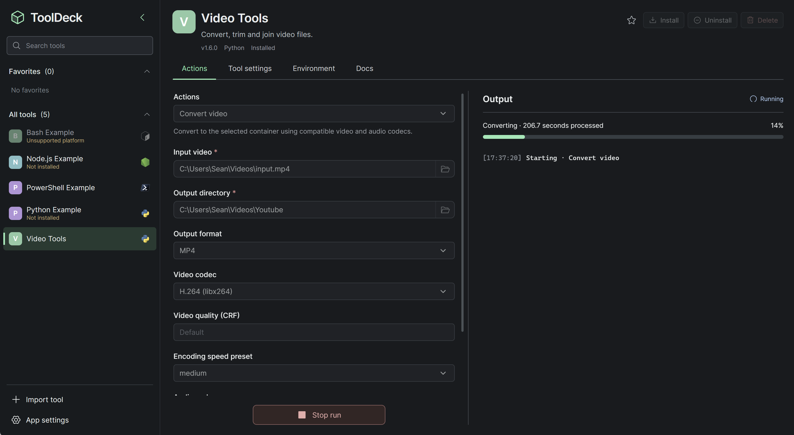

# ToolDeck

[English](README.md) | 简体中文

ToolDeck 是一款在 Windows、macOS 和 Linux 上运行本地脚本工具的桌面应用。导入 ZIP 工具包后，应用会根据包内的配置生成表单。选择操作、填写参数或选择文件，即可运行脚本、查看进度并打开结果。每个工具自行声明支持的平台和运行时。

| 文档 | 适合什么时候阅读 |
| --- | --- |
| [应用使用说明](docs/user-guide.zh-CN.md) | 导入工具、准备运行环境、执行操作或管理工具数据。 |
| [工具包开发指南](docs/tool-development.zh-CN.md) | 将 Python、Node.js、Bash 或 PowerShell 脚本做成可导入的工具。 |

## 从源码启动

准备好 Node.js 和 npm、Rust，以及当前平台所需的 Tauri 2 开发环境。在仓库根目录执行：

~~~sh
npm install
npm run desktop:dev
~~~

要体验示例，执行 `npm run package:examples`，然后在应用中导入 `artifacts/tools` 下的 ZIP。[示例源码](examples/) 覆盖四种运行时。

## 构建与测试

~~~sh
npm run desktop:build
npm run build
npm test
cargo test --manifest-path src-tauri/Cargo.toml --lib
~~~

第一条命令构建桌面可执行程序，第二条检查 TypeScript 并构建前端。运行涉及 Python 或 uv 的测试时，可以通过 `TOOLDECK_TEST_PYTHON` 或 `TOOLDECK_TEST_UV` 指定可执行文件。uv 集成测试还需要能从 `PATH` 找到 Python。

## 发布版本

在仓库根目录执行 `npm run set-version -- 0.2.0`，将示例版本替换为要发布的版本号。脚本会同步更新 npm、Tauri、Cargo 的版本声明和两个锁文件。提交改动后，再为该提交打标签。

推送与 Tauri 应用版本对应的 Git 标签，例如版本 `0.1.0` 使用 `v0.1.0`。GitHub Actions 会分别构建 Windows x64 安装程序、兼容 Intel 和 Apple Silicon 的 macOS 磁盘映像，以及 Linux x64 Debian 安装包。三个构建均成功后，工作流会将安装包发布到该标签对应的 GitHub Release。
